Read the transmission as text

### Beneath the surface

The handle is **Omeganees**. The curiosity is personal. I'm **Anees Imran**. I like the moment an idea stops being a sketch and starts answering back. A strange little interaction. One detail you almost miss. Then you notice it — and try it again.

### The build loop

Every good rabbit hole starts with **“what if?”**

1. **Chase it.** Start with the idea that will not leave you alone.
2. **Make it real.** Trade a perfect imaginary thing for a working, imperfect one.
3. **Give it soul.** Tune the small details until it feels unmistakable.

Useful enough to keep. Strange enough to remember.

### Completely unofficial incident report

The linter has entered witness protection.

- **00:01** Source code detected. Confidence: unreasonable.
- **00:02** Warning prepared. Warning reconsidering its career.
- **00:03** Developer says: “Okay, but hear me out.”
- **00:04** Curiosity wins. Another experiment begins.

Fictional incident. Real commitment to making the details count.

### Next transmission

Have a beautifully unreasonable idea? Skip the polished pitch. Tell me the part you cannot stop thinking about.

[Softrunch](https://softrunch.com) · [Say hello](mailto:anees.imran@outlook.com) · [Explore](https://github.com/Omeganees?tab=repositories)

