<p align="center">
  
</p>

<p align="center">
  <a href="https://softrunch.com"><strong>SOFTRUNCH ↗</strong></a>
  &nbsp;&nbsp; / &nbsp;&nbsp;
  <a href="mailto:anees.imran@outlook.com"><strong>SAY HELLO ↗</strong></a>
  &nbsp;&nbsp; / &nbsp;&nbsp;
  <a href="https://github.com/Omeganees?tab=repositories"><strong>EXPLORE ↗</strong></a>
</p>

<br>

### 01 / THE HUMAN BEHIND THE HANDLE

I'm **Anees Imran**. Around here, it's **Omeganees**.

> Writing code so unhinged that even the linter is scared to throw a warning.

A little irreverence belongs in the source code. A little personality belongs in the interface. Welcome to my corner of the internet.

<br>

<table>
<tr>
<td width="50%" valign="top">

### ⌘ &nbsp; THE SIGNAL

**Code with character.**

Curiosity at the start. Care in the details. Something worth opening twice at the end.

</td>
<td width="50%" valign="top">

### Ω &nbsp; THE FREQUENCY

**A healthy amount of chaos.**

Question the obvious. Try the strange idea. Keep the part that makes it interesting.

</td>
</tr>
</table>

<br>

### 02 / TRANSMISSION


```text
$ whoami
  Anees Imran / @Omeganees

$ cat philosophy.txt
  Make it work.
  Give it character.
  Refine until it feels right.

$ ping human
  softrunch.com
  anees.imran@outlook.com
```

<details>
<summary><strong>▸ Open the linter's incident report</strong></summary>

<br>


```text
[INFO]  Developer detected.
[WARN]  Conventional thinking not found.
[INFO]  Attempting to file a warning...
[FAIL]  Warning intimidated by source code.
[ OK ]  Proceed with curiosity.
```

<sub>A fictional incident. The linter is fine. Probably.</sub>

</details>

<br>

---

<p align="center">
  <sub>HAVE AN INTERESTING IDEA?</sub><br><br>
  <a href="mailto:anees.imran@outlook.com"><strong>Let's make something with character. ↗</strong></a><br><br>
  <sub>ANEES IMRAN &nbsp; / &nbsp; OMEGANEES &nbsp; / &nbsp; Ω</sub>
</p>
